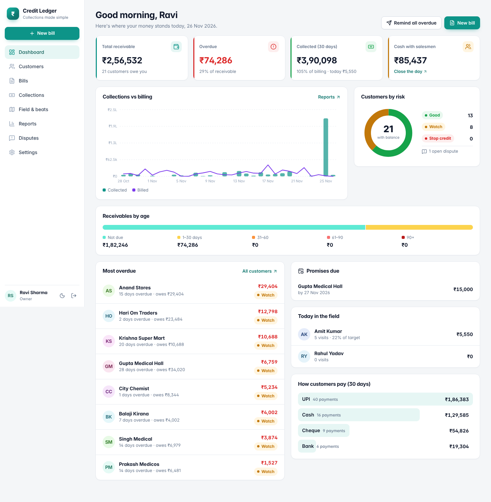
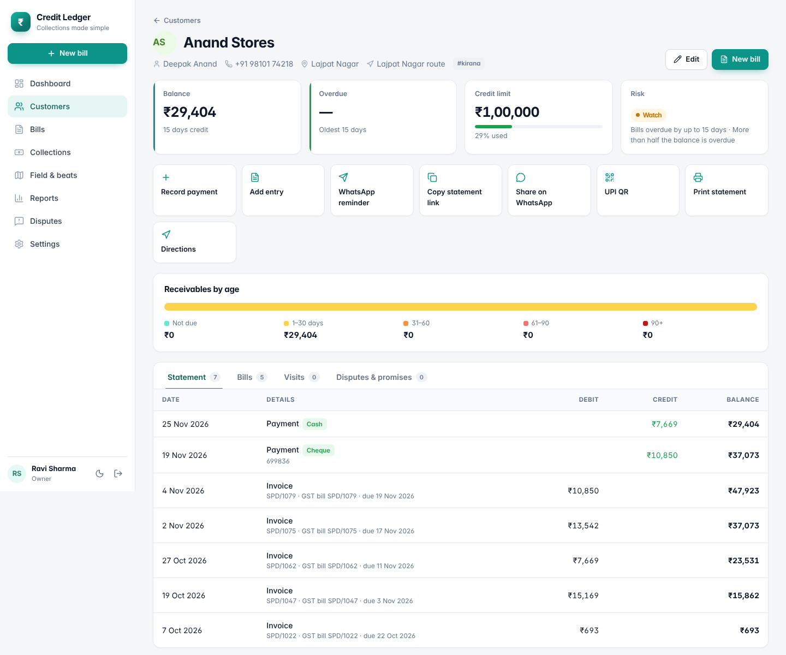
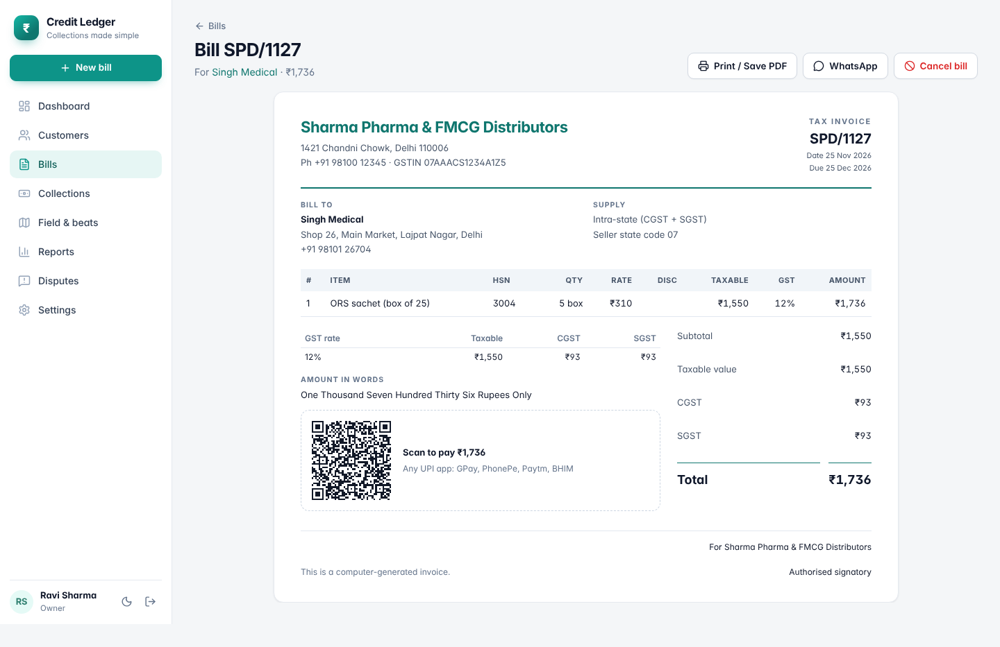
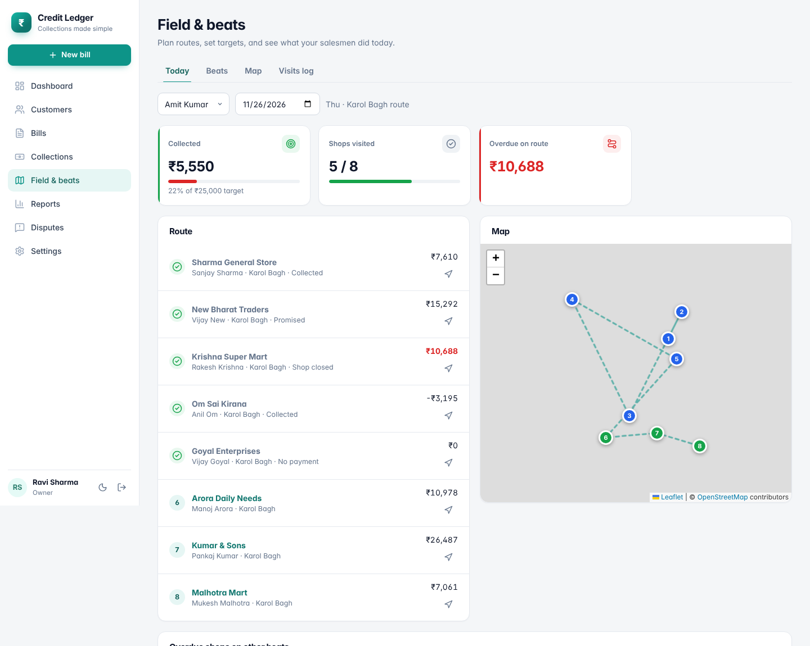
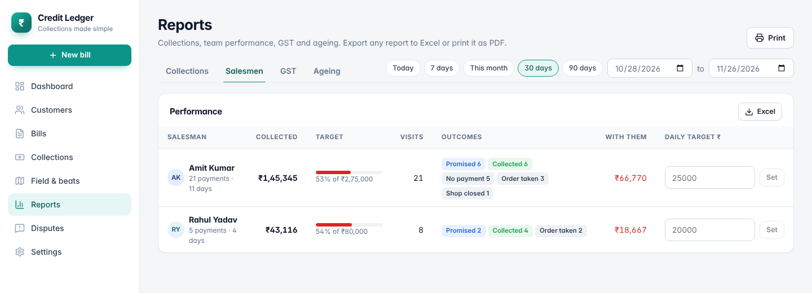
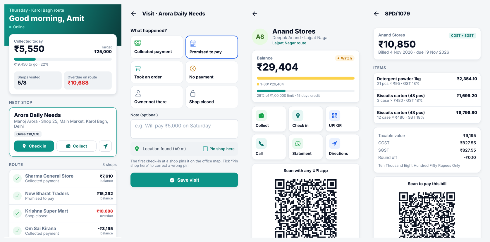

# Credit Ledger

Credit and collections software for distributors and wholesalers who sell to retailers on credit. It works like Khatabook or OkCredit on the surface, and adds what a distributor with 100–500 retailers and a field sales team needs:

- **Immutable ledger** per retailer: invoices, payments, credit notes, adjustments, bounced cheques. Corrections are new entries; history can't be edited or deleted (enforced by a database trigger).
- **Aging and risk flags.** FIFO allocation of payments to the oldest bills, 0/30/60/90+ aging, and a transparent green/amber/red risk score with plain-language reasons ("Balance is above the credit limit").
- **Two-sided ledger.** Each retailer gets a signed WhatsApp link to their live statement, with a **Pay with UPI** button and a **Report a problem** button on every line. Disputes land in a queue for the office.
- **Android app** for the field team, with **offline collections** that sync automatically and can never be recorded twice.
- **Salesman collections with instant receipts.** When a salesman records cash, cheque or UPI, the retailer immediately gets a WhatsApp receipt with the amount and the salesman's name. The office closes each salesman's day and the system records any shortfall.
- **WhatsApp reminders** (single or bulk, with a 72-hour cooldown) through the official WhatsApp Cloud API.
- **Payment promises from replies.** A reply like "kal 10000 rs bhej dunga" becomes a promise dated tomorrow for ₹10,000, later marked kept or broken. Works in English and romanised Hindi.
- **UPI to the distributor's own UPI ID.** No payment gateway, no fees, and this system never holds money.
- **Tally sync agent** (Go, read-only) that mirrors Sundry Debtors balances from TallyPrime so the app and the books can be reconciled.
- **GST bills** with items, HSN, discounts and 0–28% GST. CGST/SGST or IGST is chosen automatically from the GSTINs, totals round to the rupee, and every bill carries a **UPI QR** for its amount. Bills post to the ledger, print as A4 or PDF, and are cancelled with a credit note, never edited.
- **Customer management:** owner/contact person, area, address, tags, map location, archive. **Bulk import** from Excel or CSV with column matching, a dry-run check and opening balances.
- **Salesman tools:** **beats** (fixed routes on chosen weekdays, in visiting order), **today's route** on the phone, **check-ins** with outcome and GPS (the first check-in pins the shop on the map), **daily targets** and a **map** of every shop coloured by risk.
- **Reports:** collections vs billing by day, payment modes, salesman performance against target, **GST summary** (by rate and HSN, B2B/B2C), ageing. Every report exports to **Excel**.
- **Roles:** owner, accountant, salesman. Salesmen can only record collections and visits, and see their own.
- **Multi-tenant** with Postgres **row-level security**: tenant isolation is enforced by the database, not just application code.

## Screens



| Customer | GST bill with UPI QR |
|---|---|
|  |  |

| Today's route (office view) | Salesman performance |
|---|---|
|  |  |

### Android app (salesmen and owners)



## Architecture

```
apps/api         Fastify + TypeScript + Postgres (RLS). REST API, WhatsApp webhook, agent endpoint.
apps/web         React + Vite. Office dashboard, customers, disputes, settings, retailer statement page.
apps/mobile      React Native + Expo (SDK 58). Android app for the field: customers, offline collections, sync.
packages/shared  Types, money formatting, typed API client and the offline outbox, used by web and mobile.
agent            Go. Runs on the office PC next to Tally; outbound-only HTTPS to the API.
```

See [apps/mobile/README.md](apps/mobile/README.md) for running the Android app and publishing it on Google Play.

Money is stored as integer **paise** everywhere. Dates are `YYYY-MM-DD` in India time.

## Run it (Docker only — nothing else to install)

You need **Docker Desktop** or **OrbStack** on your Mac. Postgres, Node and Go all run in containers, so there is no `psql` or Postgres install on your machine. Run `make help` to list every command.

### Development (hot reload)

```bash
make dev          # Postgres + API (:4000) + web (:5173) with hot reload
```

Open http://localhost:5173. The first run installs packages into Docker volumes, which takes a minute. To try everything with sample data, run `make seed` in a second terminal and sign in as **demo@creditledger.in** / **demo-password-123** (salesman: amit@creditledger.in, same password). Edit files in your editor and the API and web app reload. Other commands:

| Command | What it does |
|---|---|
| `make dev-detached` / `make logs` / `make down` | Run in the background, follow logs, stop |
| `make seed` | Load demo data: 24 shops, 3 beats, 2 salesmen, two months of bills and payments |
| `make psql` | Open `psql` inside the Postgres container |
| `make reset-db` | Stop and wipe the development database |
| `make test` | Typecheck + all tests against a throwaway Postgres, plus the Go agent tests |

To browse the database with a GUI (TablePlus, DBeaver, pgAdmin), connect to `localhost:5432`, user `ledger`, password `ledger`, database `ledger`. That port only listens on your Mac, not your network.

### Production-like (Docker Compose)

```bash
make prod         # creates .env with random secrets the first time, then builds and starts
```

Open http://localhost:8080, create your business account, then in **Settings** add your UPI ID and a salesman. With `WHATSAPP_MODE=console` (the default), messages are written to the API logs instead of being sent. `make prod-down` stops it; your data stays in the `db_data` volume.

### Kubernetes (Docker Desktop or OrbStack)

Turn on Kubernetes in Docker Desktop (Settings → Kubernetes) or OrbStack, then:

```bash
make k8s-up       # builds images, creates secrets once, deploys Postgres + API (2) + web (2)
make k8s-open     # http://localhost:8080
make k8s-status   # pods, services, volumes
```

The manifests are in `deploy/k8s/` (Kustomize): a Postgres StatefulSet with a 5 Gi volume, API and web Deployments with rolling updates, probes, a PodDisruptionBudget, locked-down security settings and NetworkPolicies. Secrets are generated by `make k8s-secrets` and never stored in git. `make k8s-down` removes the app but keeps the database volume and secrets; `make k8s-delete-data` deletes everything.

Notes:
- Using **kind** instead? Run `make k8s-load` after `make images` to copy the images into the cluster.
- Docker Desktop's built-in Kubernetes does not enforce NetworkPolicies. They take effect on clusters with Calico or Cilium (most managed clusters).
- For a real server, push the images to a registry (see the commented `images:` block in `deploy/k8s/kustomization.yaml`), then apply `deploy/k8s/extras/ingress.yaml` (HTTPS via cert-manager) and `extras/hpa.yaml` (autoscaling).

### Without Docker

Requirements: Node 20+, Postgres 14+, Go 1.22+. Set `DATABASE_URL`, `JWT_SECRET` and `STATEMENT_LINK_SECRET`, then `npm install`, `npm run dev:api` and `npm run dev:web`. Tests need `TEST_DATABASE_URL`.

### Tests

The integration suite drops and recreates the `public` schema of the test database. `make test` uses a separate in-memory Postgres for this. **Never point `TEST_DATABASE_URL` at real data.**

46 API tests, 11 shared-package tests (including the offline outbox) and Go agent tests. What they cover: money parsing and formatting, FIFO aging, risk rules, UPI links, signed statement tokens (tampering and expiry), the Hindi/English promise parser, password hashing, webhook signatures, and an end-to-end API run covering registration, roles, RLS isolation between tenants, ledger immutability, collections with receipts and day close, the public statement and disputes, reminders with cooldown, the signed webhook, the dashboard, and Tally sync.

## WhatsApp setup (Meta Cloud API)

1. Create a Meta Business account and a WhatsApp Business app; add your business number.
2. Create two **Utility** message templates (Hindi and English versions under the same name):
   - `payment_reminder`, body variables: `{{1}}` customer name, `{{2}}` business name, `{{3}}` amount due, `{{4}}` statement link.
     Example: *Namaste {{1}}, {{2}} se aapka {{3}} baaki hai. Apna khata dekhein aur UPI se payment karein: {{4}}*
   - `payment_receipt`, body variables: `{{1}}` customer, `{{2}}` amount, `{{3}}` mode, `{{4}}` collected by, `{{5}}` receipt number, `{{6}}` business.
3. Set in `.env`: `WHATSAPP_MODE=cloud`, `WHATSAPP_TOKEN`, `WHATSAPP_PHONE_NUMBER_ID`, `WHATSAPP_APP_SECRET`, `WHATSAPP_VERIFY_TOKEN`.
4. Point the app's webhook at `https://<your-domain>/webhooks/whatsapp` with your verify token, and subscribe to `messages`.
5. In the app's **Settings**, enter the same WhatsApp phone number ID so replies are routed to your business.

Utility messages are billed per message by Meta (about ₹0.15 each in India at the time of writing). In production, the webhook rejects unsigned requests.

## Tally sync agent

1. In TallyPrime: **Help → Settings → Advanced Configuration**, enable the HTTP server (port 9000), and keep the company loaded.
2. In the app: **Settings → Tally sync agent keys → Create key**. Copy the key (shown once).
3. On the Tally PC:

```bat
set CL_API_URL=https://your-domain
set CL_AGENT_KEY=clk_...
set SYNC_INTERVAL=15m
cl-agent.exe
```

Build it with `cd agent && GOOS=windows GOARCH=amd64 go build -o cl-agent.exe ./cmd/agent`. Run it as a Windows service with a tool like NSSM or Task Scheduler.

The agent matches ledgers by name, links them to existing customers by mobile number, and creates customers for new ledgers that have a mobile number. Balances appear in the **Tally** column of the customer list; a highlighted value means the app and Tally disagree.

> **Verify on your Tally first:** the agent assumes Tally's XML convention that debit balances are negative. Run it once with `SYNC_INTERVAL=once` and compare a few balances.

## Security notes

- Tenant isolation: every tenant query runs as the `app_user` role with `app.tenant_id` set, under Postgres row-level security. Only registration, login, webhook routing and agent-key lookup use the owner role.
- Passwords: scrypt. Agent keys: stored as SHA-256 hashes, shown once.
- Statement links: HMAC-signed, expiring (default 30 days), scoped to one customer, read-only plus disputes, rate-limited.
- Every write is recorded in `audit_log`.
- Helmet headers, CORS allow-list, rate limiting (stricter on login and public links), 1 MB body limit.

## Before you go live (things only you can do)

- [ ] Real WhatsApp Business account, approved templates, and Meta Tech Provider status if you send from each distributor's own number.
- [ ] A domain with HTTPS (e.g. Caddy or a cloud load balancer in front of the `web` container), hosted in India.
- [ ] Managed Postgres with daily backups and a tested restore.
- [ ] Error monitoring (e.g. Sentry) and uptime alerts on `/healthz`.
- [ ] Privacy policy and terms (DPDP Act): retailer phone numbers are personal data.
- [ ] Code-signing certificate for the Windows agent, so SmartScreen and antivirus don't block it.
- [ ] Security review / penetration test before onboarding paying customers.
- [ ] Check your employer's policy on outside work before selling.

## Known limitations and next steps

- Reminders are sent synchronously; move bulk sending to a job queue (e.g. pg-boss) as volume grows.
- The salesman experience is the responsive web app; a native offline-first app (React Native) is the next big step for poor-signal markets.
- Promise parsing is rule-based; an LLM can be added behind `parsePromise` for messier replies.
- Tally sync is balances only; invoice-level sync would let the app post invoices automatically.
- Marg ERP integration (for pharma distributors) needs API access through a Marg partner.
- JWTs are stored in `localStorage`; consider httpOnly cookies with CSRF protection for higher security.
